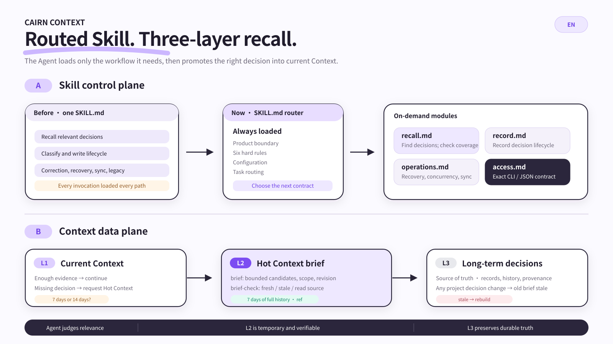

# Cairn Context

**English | [中文](README.zh-CN.md)**

Decision memory that follows the work, not the Agent.

Cairn keeps confirmed project decisions in a repository you own, then brings the right decision into the right task Context at the right time. It works with Claude Code, Codex, and other local Agents that can load a `SKILL.md`, read files, and run Python.



*The Agent judges relevance. L2 is temporary and verifiable. L3 preserves durable truth.*

## What changed

Cairn has two cooperating planes.

### Skill control plane

`SKILL.md` stays small. It keeps the product boundary, six hard rules, configuration resolution, and task routing. The Agent loads one focused contract only when the task needs it:

- `references/recall.md` — find decisions and diagnose incomplete Context;
- `references/record.md` — create, supersede, revoke, or correct a decision;
- `references/operations.md` — recover interrupted writes and handle synchronization;
- `references/access.md` — the exact CLI and JSON contract.

### Context data plane

Cairn uses three layers without changing what a durable decision is:

1. **L1 · Current Context** — the host Agent's current task, user input, and evidence already loaded.
2. **L2 · Hot Context brief** — a short-lived, task-scoped set of candidate decisions held by the host.
3. **L3 · Long-term decisions** — the repository, the sole source of truth for original records, history, corrections, and revisions.

If L1 already has enough evidence, the Agent continues. If a decision is missing, it checks L2. If L2 is incomplete, stale, truncated, conflicted, or insufficient, the Agent reads the exact L3 record. Known decision IDs and lifecycle changes go directly to L3.

## What it does

- Preserves confirmed decisions across Agent sessions and tools.
- Returns a bounded candidate brief for one project and work thread.
- Verifies a brief against the current project snapshot before reuse.
- Keeps the original decision, scope, exclusions, overturn conditions, source, and revision available in L3.
- Preserves history when a decision is replaced or revoked.
- Records corrections without silently rewriting the past.
- Refuses incomplete, conflicting, stale, or unsafe operations with structured diagnostics.

## Try the recall flow

Build a task-scoped L2 brief:

```bash
python3 ~/cairn/scripts/cairn.py brief \
  --project your-project \
  --thread current-task \
  --focus pricing \
  --focus credits \
  --limit 5 > /tmp/cairn-brief.json
```

Check it before reuse:

```bash
python3 ~/cairn/scripts/cairn.py brief-check \
  --project your-project \
  --thread current-task < /tmp/cairn-brief.json
```

The result is one of these behaviors:

- `fresh + use_brief` — the projection still matches L3 and contains sufficient boundaries;
- `fresh + read_source` — the projection is current, but the Agent must open original evidence;
- `stale + rebuild` — a decision in the project changed, so the old projection must not be reused.

Brief selection is deterministic literal matching over decision IDs, titles, conclusions, and scopes. It does not claim semantic completeness. An empty brief is not proof that no relevant decision exists.

Open an exact L3 decision when you know its ID or need the full source:

```bash
python3 ~/cairn/scripts/cairn.py get \
  --project your-project \
  --id decision-id
```

## Durable decision contract

L2 does not change decision input or durable output. A decision still requires explicit user intent and belongs to one project and scope.

Decision files remain plain Markdown:

```markdown
---
project: your-project
decision: pricing-model
status: valid
decided_by: Pat
decided_at: 2026-11-13
---

# Pricing model

## Decision
Use annual billing.

## Rationale
To be validated

## Scope
Paid plans.

## Explicitly excluded
Enterprise contracts.

## Overturn signal
Renewal data contradicts the assumption.
```

The lifecycle remains:

- `create` — a new confirmed decision;
- `supersede` — a confirmed replacement that preserves its predecessors;
- `revoke` — a withdrawal without a replacement;
- `correct` — repair of an inaccurate record without changing its lifecycle.

Every successful write is validated, indexed, returned with revisions, and read back. A project decision change invalidates every existing brief for that project, including briefs that did not previously match the changed record.

## Install

Requirements: Python 3.9 or newer. Cairn uses only the Python standard library.

Clone this public source repository, then create a separate private decision repository.

Claude Code:

```bash
bash install.sh \
  --identity "Your Name" \
  --project "your-project" \
  --repository "$HOME/cairn" \
  --claude-code
```

Codex:

```bash
bash install.sh \
  --identity "Your Name" \
  --project "your-project" \
  --repository "$HOME/cairn" \
  --codex
```

Pass both host flags to install both Skills. For another compatible Agent, use `--skills-dir "/path/to/skills"`.

The installer:

1. creates a local Cairn repository from `template/`;
2. writes `~/.cairn/config.json`;
3. installs the routed Skill and its references;
4. creates the initial project index.

It refuses to overwrite a non-empty repository, an existing Skill, or a configuration that points somewhere else.

## Existing installations

Updating this public checkout does not change an installed Skill or private repository. Inspect first:

```bash
python3 install.py status --json
python3 install.py upgrade --dry-run --json
```

Upgrade managed repository scripts only:

```bash
python3 install.py upgrade --json
```

Upgrade installed Skills too:

```bash
python3 install.py upgrade --codex --claude-code --json
```

Upgrade preserves decisions, project files, protocol text, configuration, and synchronization settings. Passing a host flag replaces the installed Skill files with this public version, so review customized Skills before upgrading them.

## Safety and recovery

- The repository is the only durable source of truth; L2 briefs are host-held projections.
- Brief generation and checking are read-only and create no cache files in Cairn.
- The writer checks expected revisions and serializes Cairn writers.
- Interrupted writes retain a local transaction journal and can resume with the same request ID.
- Recovery refuses to overwrite external edits that differ from both recorded states.
- Generated paths are repository-relative; linked files and redirected directories are rejected.
- Decision capture never authorizes Git push, public publication, or writes to source code and product documents.

See [the unified access contract](references/access.md) for command arguments, JSON fields, refusal codes, truncation rules, and recovery behavior.

## Optional Git synchronization

The generated private repository includes an optional macOS 30-minute sync script. The installer never enables it.

Initialize and push the private repository yourself, then run:

```bash
bash "$HOME/cairn/scripts/setup-autosync.sh"
```

The setup refuses a public GitHub remote when GitHub CLI can verify visibility. A sync conflict stops and preserves the local commit for manual resolution.

## Boundaries

Cairn is decision memory, not a general activity or preference store.

It does not provide:

- activity capture or screen history;
- inferred user preferences;
- embeddings or semantic ranking;
- a hosted account or database;
- a background Hot Context service;
- automatic promotion from L2 into durable memory;
- guaranteed semantic recall.

L2 uses literal focus terms and bounded excerpts. The Agent remains responsible for relevance, project applicability, and deciding when original evidence is required.

## Repository layout

```text
cairn-context/                 public source
├── SKILL.md                   compact router and hard rules
├── references/
│   ├── recall.md
│   ├── record.md
│   ├── operations.md
│   └── access.md
├── install.py
├── template/                  private repository template and Python kernel
├── docs/schema/               published JSON contracts
└── tests/                     unit and conformance cases

~/cairn/                       generated private decision repository
├── AGENTS.md
├── projects/<project>/
│   ├── decisions/*.md
│   ├── decisions-index.md
│   └── state.md
├── protocol/
└── scripts/
```

## Connect an Agent

For an existing installation or a new local Agent, use [the connection procedure](docs/connect.md). It checks configuration and capabilities before changing anything, reuses an existing private repository, and returns to the original task after verification.

## Development

```bash
python3 -m unittest discover -s tests
```

The suite covers installation, upgrade, validation, pagination, exact reads, brief freshness, writer lifecycle, recovery, path isolation, and published JSON schemas across Python 3.9 and 3.12.

## License

MIT
