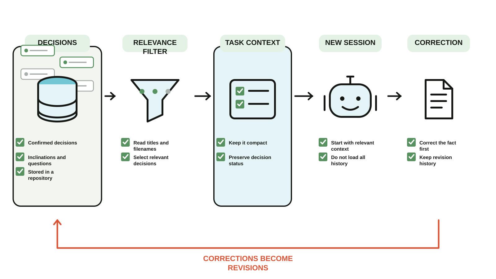

# Cairn Context

**English | [中文](README.zh-CN.md)**

A Skill that lets a new agent session find the project decisions that are already confirmed and relevant to the task, so you stop re-explaining them.

It works with Claude Code, Codex, and any agent that loads a `SKILL.md`. Your decisions live in a repository you own; this public repository holds only the Skill, an installer, and a template.



*Mechanism diagram, not a product screenshot. Confirmed decisions are filtered into compact task context; user corrections return to revision history. The bilingual source is [`docs/mechanism.json`](docs/mechanism.json).*

## What it does

- Reads only the decisions that bear on the current task. The agent picks them by file name and title (see Limitations).
- Tells a confirmed decision apart from an inclination, an open question, and a temporary experiment. If the signal is unclear, it asks once.
- Keeps history when a decision changes. The old file stays, and a `supersedes` link points from the new one to it.
- Logs your corrections, so a wrong judgment can be traced.

These are instructions to the agent, not enforced guarantees. How well they hold depends on the model's instruction following.

## Install

Requires Python 3.9 or newer; no third-party Python packages are needed.
Clone this public repository, then run the installer with the agent you use.
The installer creates a **separate private context repository** for your decisions.
If you already have one, use [upgrade](#existing-installations), not install.

For Claude Code:

```bash
bash install.sh --identity "Your Name" --project "your-project" --repository "$HOME/cairn" --claude-code
```

For Codex:

```bash
bash install.sh --identity "Your Name" --project "your-project" --repository "$HOME/cairn" --codex
```

For both, pass both flags. For any other agent, point at its skills directory:

```bash
bash install.sh --identity "Your Name" --project "your-project" --repository "$HOME/cairn" --skills-dir "/path/to/skills"
```

On Windows, run the Python installer directly (PowerShell):

```powershell
python install.py install --identity "Your Name" --project "your-project" --repository "$HOME/cairn" --codex
```

The Bash examples above work on macOS/Linux. Without a target flag, `install`
installs to Codex, as earlier versions did. `upgrade` has a different default:
it updates repository files only, unless Skill targets are explicitly selected.

The installer:

1. creates a local Cairn repository from `template/`;
2. writes the configuration (by default `~/.cairn/config.json`);
3. installs the Skill to each target. Codex also gets `agents/openai.yaml`.

It refuses to overwrite a non-empty repository, an existing Skill, or a configuration that points at another repository (pass `--replace-config` to replace it), and it checks every target before it writes anything.

## Limitations

- **Retrieval is by index, not search.** The agent reads a one-line summary of every valid decision and chooses which to open. There is no keyword search, embedding, or ranking, and the agent's choice is a judgment, not a guarantee.
- **No learning.** Corrections are appended to `protocol/benchmark/feedback.md`. Nothing reads that log to change later behavior.

## Roadmap

Not built yet, listed so you know what is missing:

- A keyword search command, for repositories with too many decisions to read as one index.
- A way to turn a repeated correction into a reviewed rule.

## Find decisions faster: the index

For each project the installer creates `projects/<project>/decisions-index.md`: one line per **valid** decision, newest first.

```text
- 2026-09-01 plain-markdown: Use plain Markdown — Decisions are stored as plain Markdown files.
```

Each line is `date id: title — first sentence of the decision`. The Skill reads this file first, then opens `decisions/<id>.md` only for the lines that matter to the task. Superseded and revoked decisions are not listed; they stay in `decisions/` as history.

The file is generated. Do not edit it. After you record or change a decision, refresh it:

```bash
python3 ~/cairn/scripts/index.py
```

The Skill does this itself after it records a decision. `index.py --check` exits with 1 when the index is missing or out of date, and `validate.py` warns about a stale index. The script uses only the standard library.

If an older installation has no `index.py`, [upgrade the repository scripts](#existing-installations),
then run `index.py` once to create the index. Upgrade itself does not regenerate indexes.

## Validate your decisions

Decision files are plain Markdown with a small frontmatter block. Check them with:

```bash
python3 ~/cairn/scripts/validate.py
```

It reads only the standard library, so there is nothing to install. It reports an error when:

- a required field is missing (`project`, `decision`, `status`, `decided_by`, `decided_at`), or `status` is not `valid`, `superseded`, or `revoked`;
- `decided_at` is not a real date in `YYYY-MM-DD` form;
- `project` or `decision` does not match where the file lives;
- `supersedes` (one id, or a list when a decision replaces several) points to a decision that does not exist, to itself, or in a loop;
- `superseded_by`, if you use it, points to a decision that does not exist;
- the decision it replaces is still marked `valid`.

It reports a warning, not an error, for:

- a missing section. English headings (`Decision`, `Rationale`, `Scope`, `Explicitly excluded`, `Overturn signal`) and Chinese headings (`结论`, `为什么`, `适用范围`, `明确不做`, `推翻条件`) are both recognized, and a file is checked against the set it uses;
- an unknown field, or an unusual id;
- a `superseded` decision that nothing replaces;
- one decision replaced by several (a split), or a `superseded_by` whose target does not list it in `supersedes`.

Options: `--json` for machine-readable output, `--strict` to fail on warnings. The exit code is 0 when there are no errors, 1 when there are, and 2 when the repository cannot be read. The Skill runs it after recording a decision if the script is present.

If an older installation has no validator, [upgrade the repository scripts](#existing-installations).

To run this project's own tests: `python3 -m unittest discover -s tests`.

## Existing installations

**Your usual Agent workflow stays the same.** Decisions remain Markdown files;
project layout, the Skill definition and the protocol text have not changed in
this integration update. You do not need to rewrite decisions or reinstall Cairn.
The JSON reader and installation status are additional entry points for programs.

Updating this public source clone does **not** update scripts already copied into
your private context repository, or Skills installed in an agent's directory.
Upgrade is recommended for the latest reader fixes, consistent configuration
lookup and validation. Continuing the existing Agent workflow does not require
an immediate upgrade, but older readers do not provide the current export safeguards.

Run the following from the **public `cairn-context` source clone**, on `main`:

```bash
git pull --ff-only
python3 install.py status --json
python3 install.py upgrade --dry-run --json
python3 install.py upgrade --json
```

On Windows, use `python` in place of `python3`; `install.sh` is a POSIX wrapper.
The commands use your configured private repository. To inspect or upgrade a
different one, add `--repository "/path/to/private-cairn"` to the relevant command.
Configuration lookup for the installer, reader, indexer and validator is
`CAIRN_CONFIG` → `CAIRN_CONFIG_ROOT/config.json` → `~/.cairn/config.json`.

- `status` reports `ready`, `not_enabled` or `error`, plus `upgrade_available`.
  `ready` does not mean the scripts are current or every decision is valid;
  inspect `upgrade_available`, `validation` and `stale_indexes` separately.
- **Do not rely on the version number alone.** A repository may already have
  `protocol/VERSION` set to `1` while its scripts predate fixes. Status compares
  the managed file contents as well; dry run lists the actual updates.
- With no target flags, upgrade writes only `scripts/index.py`,
  `scripts/validate.py`, `scripts/read.py` and `protocol/VERSION`. It leaves
  decisions, project files, indexes, configuration, protocol text and agent
  instructions unchanged. It does not enable or change autosync.
- **Keep customized Skills by omitting target flags.** Passing `--codex`,
  `--claude-code`, `--skills-dir` or `--detect` can replace a differing installed
  Skill with the public copy; it does not merge your customizations. It updates
  only existing Skill directories. To refresh an uncustomized Codex Skill too,
  preview `python3 install.py upgrade --codex --dry-run --json`, then remove
  `--dry-run` to apply it.

The validator now requires zero-padded dates such as `2026-01-01`. JSON exports
report and omit decisions with invalid history links or cycles, and reject linked
files/directories rather than reading their targets. Existing records are not
rewritten to fix these issues. After upgrading, run the installed
`scripts/validate.py` against your private repository and review any errors.

## Use from another program

To read decisions as JSON, for example from an app, use:

```bash
python3 ~/cairn/scripts/read.py --project your-project --since 2026-10-01
```

Generated paths are repository-relative; linked files and directories are rejected.
`--project` plus `--since` exports one project's decisions from one date on.
Authored content is preserved, so review any references in it before sharing. The input
and output formats, the status states and the conformance cases that another
implementation must pass are in [`docs/contract.md`](docs/contract.md).

## Optional 30-minute Git sync

The generated Cairn repository includes an optional macOS LaunchAgent. Every 30 minutes it commits local changes, rebases onto the remote branch, and pushes. A conflict stops the sync and keeps the local commit for you to resolve.

First create a **private** GitHub repository and push the generated Cairn repository:

```bash
cd "$HOME/cairn"
git init -b main
git add .
git commit -m "init: create Cairn context"
gh repo create YOUR_ACCOUNT/cairn --private --source . --remote origin --push
```

Then enable autosync yourself:

```bash
bash "$HOME/cairn/scripts/setup-autosync.sh"
```

The Skill installer never enables autosync. When the GitHub CLI is available, setup refuses to sync to a repository that is public.

## Repository layout

```text
~/cairn/
├── AGENTS.md
├── CLAUDE.md              imports AGENTS.md
├── protocol/
│   ├── README.md
│   ├── VERSION
│   └── benchmark/
│       ├── feedback.md
│       └── cases.yaml
├── scripts/
│   ├── setup-autosync.sh
│   ├── sync.sh
│   ├── validate.py
│   ├── index.py
│   └── read.py
└── projects/
    └── your-project/
        ├── README.md
        ├── state.md
        ├── decisions-index.md   generated
        └── decisions/
```

## Related projects

Two earlier projects are archived and no longer maintained: [Cairn Lite](https://github.com/alexliu072903-bit/cairn-lite), which kept the context inside the project folder, and [Shared Project Context](https://github.com/alexliu072903-bit/shared-project-context), which tracked goals and evidence across people and agents.

## Privacy boundary

Do not point several people at one personal Cairn repository just to share the Skill. Share this public Skill and keep each person's context repository private. Create a separate team repository only for decisions that are meant to be read by the team.

## License

MIT
