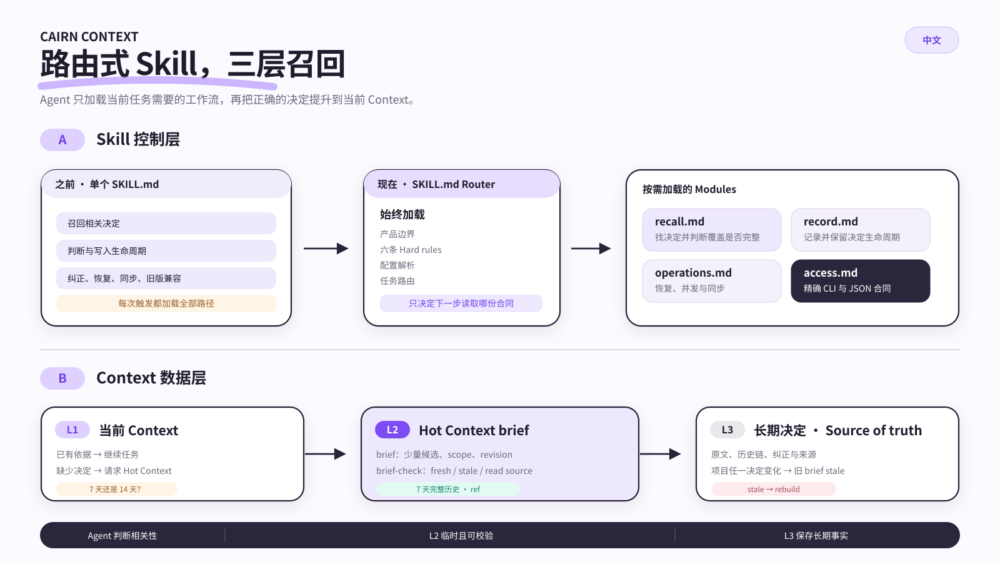

# Cairn Context

**[English](README.md) | 中文**

让决策跟随工作，而不是困在某一个 Agent 里。

Cairn 把已经确认的项目决定保存在你拥有的仓库中，并在正确的任务时刻，把正确的决定带入当前 Context。支持 Claude Code、Codex，以及能够加载 `SKILL.md`、读取本地文件和运行 Python 的其他 Agent。



*Agent 判断相关性。L2 临时且可校验。L3 保存长期事实。*

## 这次形成的结构

Cairn 由两个相互配合的平面组成。

### Skill 控制层

`SKILL.md` 保持紧凑，只保留产品边界、六条 Hard rules、配置解析和任务路由。Agent 只在当前任务需要时加载一份具体合同：

- `references/recall.md`：寻找决定并判断 Context 是否完整；
- `references/record.md`：创建、替代、撤销或纠正决定；
- `references/operations.md`：恢复中断写入并处理同步；
- `references/access.md`：精确的 CLI 与 JSON 合同。

### Context 数据层

Cairn 使用三层 Context，同时保持“什么是长期决定”不变：

1. **L1 · 当前 Context**：宿主 Agent 当前的任务、用户输入和已经读入的证据。
2. **L2 · Hot Context brief**：由宿主短期持有、限定在一个项目和工作线程内的候选决定。
3. **L3 · 长期决定**：唯一事实来源，保存原始记录、历史链、纠正和 revision。

L1 已有足够依据时，Agent 直接继续。缺少决定时，先检查 L2；L2 不完整、过期、被截断、存在冲突或不足以支撑判断时，再读取准确的 L3 原始记录。已知决定 ID、纠正、撤销、替代和高影响核对直接进入 L3。

## 它能做什么

- 让确认的决定跨 Agent、跨会话持续存在。
- 为一个项目和工作线程返回有界的候选 brief。
- 在复用前，根据当前项目 snapshot 校验 brief 是否仍然有效。
- 在 L3 保留决定原文、scope、exclusions、推翻条件、来源和 revision。
- 决定变化时保留旧记录和替代关系。
- 记录纠正，而不偷偷改写历史。
- 对不完整、冲突、过期或不安全的操作返回结构化诊断。

## 体验三层召回

生成一个任务级 L2 brief：

```bash
python3 ~/cairn/scripts/cairn.py brief \
  --project your-project \
  --thread current-task \
  --focus pricing \
  --focus credits \
  --limit 5 > /tmp/cairn-brief.json
```

再次使用前检查它：

```bash
python3 ~/cairn/scripts/cairn.py brief-check \
  --project your-project \
  --thread current-task < /tmp/cairn-brief.json
```

系统会给出三种行为：

- `fresh + use_brief`：候选与 L3 一致，决定边界完整，可以使用；
- `fresh + read_source`：候选仍然新鲜，但必须打开原始证据；
- `stale + rebuild`：项目决定已经变化，旧候选不能继续使用。

Brief 对决定 ID、标题、结论和 scope 做确定性的字面匹配，不承诺语义召回完整。没有候选不代表不存在相关决定。

已知决定 ID 或需要完整依据时，直接读取 L3：

```bash
python3 ~/cairn/scripts/cairn.py get \
  --project your-project \
  --id decision-id
```

## 长期决定合同

L2 不改变决定的 input 和 durable output。决定仍然必须来自用户明确意图，并属于一个项目和适用范围。

决定继续使用普通 Markdown：

```markdown
---
project: your-project
decision: pricing-model
status: valid
decided_by: Alex
decided_at: 2026-11-13
---

# 定价模型

## 结论
使用年付模式。

## 为什么
待验证

## 适用范围
付费方案。

## 明确不做
企业合同。

## 推翻条件
真实续费数据否定当前假设。
```

决定生命周期保持不变：

- `create`：新增一条已经确认的决定；
- `supersede`：使用新决定替代旧决定并保留历史；
- `revoke`：撤销一条决定但不提供替代；
- `correct`：纠正错误记录，同时保持原生命周期。

每次成功写入都会完成校验、索引刷新、revision 返回和读回检查。项目中任一决定变化都会让该项目已有的 brief 失效，包括之前没有匹配到的决定。

## 安装

要求 Python 3.9 或更高版本。Cairn 只使用 Python 标准库。

先克隆这个公开源码仓库，再创建一个独立的私人决定仓库。

Claude Code：

```bash
bash install.sh \
  --identity "你的名字" \
  --project "your-project" \
  --repository "$HOME/cairn" \
  --claude-code
```

Codex：

```bash
bash install.sh \
  --identity "你的名字" \
  --project "your-project" \
  --repository "$HOME/cairn" \
  --codex
```

同时传入两个宿主参数可安装两份 Skill。其他兼容 Agent 使用 `--skills-dir "/path/to/skills"`。

安装器会：

1. 根据 `template/` 创建本地 Cairn 仓库；
2. 写入 `~/.cairn/config.json`；
3. 安装路由式 Skill 和相关 references；
4. 创建初始项目索引。

它会拒绝覆盖非空仓库、已经存在的 Skill，或指向其他仓库的配置。

## 已有安装升级

更新公开源码仓库不会自动修改已经安装的 Skill 或私人仓库。先检查：

```bash
python3 install.py status --json
python3 install.py upgrade --dry-run --json
```

只更新私人仓库中的托管脚本：

```bash
python3 install.py upgrade --json
```

同时更新已安装 Skill：

```bash
python3 install.py upgrade --codex --claude-code --json
```

升级不会修改决定、项目文件、Protocol 正文、配置和同步设置。传入宿主参数会用公开版本替换该宿主中的 Skill 文件，因此定制过的 Skill 应先检查差异。

## 安全与恢复

- L3 仓库是唯一长期事实来源；L2 brief 是宿主持有的临时投影。
- 生成和检查 brief 都是只读操作，不在 Cairn 中创建缓存文件。
- Writer 检查 expected revision，并串行协调 Cairn writers。
- 中断的写入保留本地 transaction journal，可使用同一个 request ID 恢复。
- 外部文件变化与事务记录不一致时，恢复过程拒绝覆盖。
- 生成路径使用仓库相对路径；符号链接和被重定向的目录会被拒绝。
- 记录决定不会自动授权 Git push、公开发布或修改源码与产品文档。

命令参数、JSON 字段、拒绝码、截断和恢复行为见[统一访问合同](references/access.md)。

## 可选 Git 同步

生成的私人仓库包含一个可选的 macOS 30 分钟同步脚本，安装器不会自动启用。

自行初始化并推送私人仓库后运行：

```bash
bash "$HOME/cairn/scripts/setup-autosync.sh"
```

如果 GitHub CLI 可以检查仓库可见性，安装器会拒绝将 Context 同步到公开仓库。出现冲突时，同步会停止并保留本地提交，等待手动处理。

## 产品边界

Cairn 是决策记忆，不是通用活动或偏好 Memory。

它不提供：

- 活动采集或屏幕历史；
- 自动推断的用户偏好；
- embedding 或语义排序；
- 托管账户和数据库；
- 后台运行的 Hot Context 服务；
- 自动把 L2 提升为长期记忆；
- 对语义召回完整性的保证。

L2 采用字面 focus 匹配和有界摘录。Agent 仍然负责判断相关性、项目归属，以及何时必须读取原始证据。

## 仓库结构

```text
cairn-context/                 公开源码
├── SKILL.md                   紧凑 Router 与 Hard rules
├── references/
│   ├── recall.md
│   ├── record.md
│   ├── operations.md
│   └── access.md
├── install.py
├── template/                  私人仓库模板和 Python kernel
├── docs/schema/               公开 JSON 合同
└── tests/                     单元与 conformance cases

~/cairn/                       生成的私人决定仓库
├── AGENTS.md
├── projects/<project>/
│   ├── decisions/*.md
│   ├── decisions-index.md
│   └── state.md
├── protocol/
└── scripts/
```

## 连接 Agent

已有安装或新的本地 Agent 可以使用[接入流程](docs/connect.md)。它会先检查配置和能力，复用已有私人仓库，并在验证后返回原任务。

## 开发与测试

```bash
python3 -m unittest discover -s tests
```

测试覆盖安装、升级、校验、分页、准确读取、brief freshness、写入生命周期、恢复、路径隔离和公开 JSON Schema，并在 Python 3.9 与 3.12 上运行。

## License

MIT
