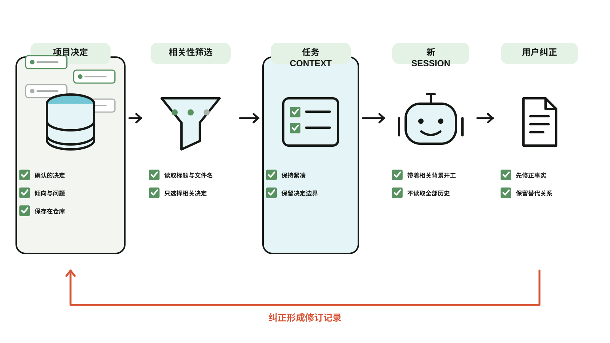

# Cairn Context

**[English](README.md) | 中文**

一个 Skill：让新开的 Agent session 找回与当前任务相关、已经确认过的项目决定，你不用再重复解释。

支持 Claude Code、Codex，以及任何能加载 `SKILL.md` 的 Agent。你的决定保存在你自己拥有的仓库里，这个公开仓库只包含 Skill、安装器和模板。



*机制说明图，不是产品截图。已经确认的决定会被筛选成紧凑的任务 Context；用户纠正会回到修订历史。双语生成源位于 [`docs/mechanism.json`](docs/mechanism.json)。*

## 它做什么

- 只读取与当前任务有关的决定。Agent 按文件名和标题挑选（见“限制”）。
- 区分已经确认的决定、暂时的倾向、开放的问题和临时实验。信号不清楚时，只问一次。
- 决定变化时保留历史：旧文件不删，新文件用 `supersedes` 指向它。
- 记录你的纠正，错误的判断可以追溯。

这些是给 Agent 的指令，不是强制保证。效果取决于模型遵循指令的能力。

## 安装

需要 Python 3.9 或更新版本，不需要第三方 Python 包。
克隆这个公开仓库，再用你使用的 Agent 对应的参数运行安装器。
安装器会另建一个**私有 Context 仓库**保存你的决定。
如果已经安装，请使用[升级](#已有安装升级)，不要重新安装。

Claude Code：

```bash
bash install.sh --identity "你的名字" --project "your-project" --repository "$HOME/cairn" --claude-code
```

Codex：

```bash
bash install.sh --identity "你的名字" --project "your-project" --repository "$HOME/cairn" --codex
```

两个都装，就同时传两个参数。其他 Agent 请指向它的 skills 目录：

```bash
bash install.sh --identity "你的名字" --project "your-project" --repository "$HOME/cairn" --skills-dir "/path/to/skills"
```

Windows 请直接运行 Python 安装器（PowerShell）：

```powershell
python install.py install --identity "你的名字" --project "your-project" --repository "$HOME/cairn" --codex
```

上面的 Bash 示例适用于 macOS/Linux。`install` 不传目标参数时，和早期版本一样安装到 Codex。
`upgrade` 的默认行为不同：不指定 Skill 目标时，只升级仓库文件。

安装器会：

1. 用 `template/` 创建本地的 Cairn 仓库；
2. 写入配置（默认是 `~/.cairn/config.json`）；
3. 把 Skill 安装到每个目标，Codex 目标还会安装 `agents/openai.yaml`。

它不会覆盖非空仓库、已有的 Skill，或指向另一个仓库的配置（需要替换时传 `--replace-config`），并且在写入任何文件之前，会先检查所有目标。

## 限制

- **靠索引找，不是搜索。** Agent 读一份“每条有效决定一行”的摘要，再决定打开哪几条。没有关键词搜索、向量或排序，Agent 的选择是一种判断，不是保证。
- **不会学习。** 纠正会追加到 `protocol/benchmark/feedback.md`，但没有任何东西读取它来改变之后的行为。

## 路线图

以下尚未实现，列出来是为了让你知道缺什么：

- 一个关键词搜索命令，用于决定多到没法当一份索引读完的仓库。
- 把重复出现的纠正，整理成经过审核的规则。

## 更快地找到决定：索引

安装器会为每个项目创建 `projects/<project>/decisions-index.md`：每条**有效**的决定一行，按日期从新到旧。

```text
- 2026-09-01 plain-markdown: 使用普通 Markdown — 决定保存为普通 Markdown 文件。
```

每一行的格式是 `日期 编号: 标题 — 决定的第一句话`。Skill 先读这个文件，再只为和任务有关的行打开 `decisions/<编号>.md`。已被替代或撤销的决定不会列出，它们仍留在 `decisions/` 里作为历史。

这个文件是自动生成的，不要手动编辑。你记录或修改决定之后，刷新它：

```bash
python3 ~/cairn/scripts/index.py
```

Skill 在记录决定之后会自己刷新。`index.py --check` 在索引缺失或过期时返回 1，`validate.py` 也会对过期的索引给出警告。脚本只用 Python 标准库。

如果早期安装缺少 `index.py`，先[升级仓库脚本](#已有安装升级)，
再运行一次 `index.py` 创建索引。升级本身不会重新生成索引。

## 校验你的决定

决定文件是普通 Markdown，带一小段 frontmatter。用下面的命令检查：

```bash
python3 ~/cairn/scripts/validate.py
```

它只用 Python 标准库，不需要安装任何东西。出现下面这些情况会报**错误**：

- 缺少必填字段（`project`、`decision`、`status`、`decided_by`、`decided_at`），或者 `status` 不是 `valid`、`superseded`、`revoked` 之一；
- `decided_at` 不是真实存在的 `YYYY-MM-DD` 日期；
- `project` 或 `decision` 和文件所在位置不一致；
- `supersedes`（一个编号，或者一条决定替代多条时写成列表）指向不存在的决定、指向自己，或者形成环；
- 如果你用了 `superseded_by`，它指向不存在的决定；
- 被替代的决定仍然标着 `valid`。

下面这些只报**警告**，不算错误：

- 缺少章节。英文标题（`Decision`、`Rationale`、`Scope`、`Explicitly excluded`、`Overturn signal`）和中文标题（`结论`、`为什么`、`适用范围`、`明确不做`、`推翻条件`）都能识别，每个文件按它实际使用的那一套检查；
- 出现未知字段，或者编号格式不常见；
- 标为 `superseded` 却没有任何决定替代它；
- 一条决定被多条替代（拆分），或者 `superseded_by` 指向的决定没有在 `supersedes` 里列出它。

选项：`--json` 输出机器可读结果，`--strict` 让警告也算失败。没有错误时退出码为 0，有错误为 1，仓库读不了为 2。如果脚本存在，Skill 在记录决定之后会自动运行它。

如果早期安装缺少校验脚本，请先[升级仓库脚本](#已有安装升级)。

运行本项目自己的测试：`python3 -m unittest discover -s tests`。

## 已有安装升级

**你平时使用 Agent 的方式基本不变。** 决定仍是 Markdown 文件；本次接入更新没有改变
项目结构、Skill 定义或协议正文。无需重写决定，也无需重新安装 Cairn。
JSON 读取器和安装状态检查，是给其他程序新增的入口。

更新这个公开源码仓库，**不会**自动更新已经复制到私有 Context 仓库的脚本，
也不会更新 Agent 目录里的 Skill。建议升级，以获得读取器修复、统一配置查找和校验规则。
继续原有 Agent 工作流不需要立即升级，但旧读取器不具备当前版本的导出保护。

在**公开的 `cairn-context` 源码仓库**中、`main` 分支上执行：

```bash
git pull --ff-only
python3 install.py status --json
python3 install.py upgrade --dry-run --json
python3 install.py upgrade --json
```

Windows 把 `python3` 换成 `python`；`install.sh` 是 POSIX 封装。
这些命令使用配置中的私有仓库。要检查或升级另一个仓库，在对应命令后添加
`--repository "/path/to/private-cairn"`。
安装器、读取器、索引器和校验器统一按以下顺序查找配置：
`CAIRN_CONFIG` → `CAIRN_CONFIG_ROOT/config.json` → `~/.cairn/config.json`。

- `status` 会报告 `ready`、`not_enabled` 或 `error`，以及 `upgrade_available`。
  `ready` 不代表脚本是最新的，也不代表所有决定都有效；还要分别查看
  `upgrade_available`、`validation` 和 `stale_indexes`。
- **不能只看版本号。** 即使 `protocol/VERSION` 已经是 `1`，脚本仍可能缺少后续修复。
  状态检查也会比较受管理文件的内容，dry run 则会列出实际需要更新的文件。
- 不加目标参数时，升级只写 `scripts/index.py`、`scripts/validate.py`、
  `scripts/read.py` 和 `protocol/VERSION`。决定、项目文件、索引、配置、协议正文和
  Agent 指令都不修改，也不会启用或改变自动同步。
- **有定制 Skill 时，先不要加目标参数。** 加上 `--codex`、`--claude-code`、
  `--skills-dir` 或 `--detect`，可能会把有差异的已安装 Skill 替换成公开版本，
  不会合并你的定制。只更新已经存在的 Skill 目录。
  如果也要更新未定制的 Codex Skill，先运行
  `python3 install.py upgrade --codex --dry-run --json`，确认后去掉 `--dry-run` 执行。

校验器现在要求日期补零，例如 `2026-01-01`。JSON 导出会报告并排除历史引用无效或形成环的决定，
也会拒绝链接文件或链接目录，而不读取链接目标。升级不会自动重写已有记录来修复这些问题。
升级后，在私有仓库上运行已安装的 `scripts/validate.py`，查看是否有错误需要处理。

## 从其他程序使用

需要把决定读成 JSON（例如从某个应用中读取）时：

```bash
python3 ~/cairn/scripts/read.py --project your-project --since 2026-10-01
```

工具生成的路径均相对仓库；不会跟随链接文件或链接目录。
`--project` 加 `--since` 可以只导出某个项目、某天之后的决定。
用户写入的内容原样保留，分享前仍需检查其中的引用。输入输出格式、状态含义，以及其他实现必须通过的一致性用例，
见 [`docs/contract.md`](docs/contract.md)。

## 可选：每 30 分钟的 Git 同步

生成的 Cairn 仓库包含一个可选的 macOS LaunchAgent。它每 30 分钟提交本地改动、变基到远端分支并推送。遇到冲突会停止同步，并保留本地提交，等你自己处理。

先创建一个**私有**的 GitHub 仓库，并把生成的 Cairn 仓库推上去：

```bash
cd "$HOME/cairn"
git init -b main
git add .
git commit -m "init: create Cairn context"
gh repo create YOUR_ACCOUNT/cairn --private --source . --remote origin --push
```

然后由你自己启用自动同步：

```bash
bash "$HOME/cairn/scripts/setup-autosync.sh"
```

Skill 安装器不会启用自动同步。GitHub CLI 可用时，如果目标仓库是公开的，设置会拒绝同步。

## 仓库结构

```text
~/cairn/
├── AGENTS.md
├── CLAUDE.md              引入 AGENTS.md
├── protocol/
│   ├── README.md
│   ├── VERSION
│   └── benchmark/
│       ├── feedback.md
│       └── cases.yaml
├── scripts/
│   ├── setup-autosync.sh
│   ├── sync.sh
│   ├── validate.py
│   ├── index.py
│   └── read.py
└── projects/
    └── your-project/
        ├── README.md
        ├── state.md
        ├── decisions-index.md   自动生成
        └── decisions/
```

## 相关项目

两个更早的项目已归档，不再维护：[Cairn Lite](https://github.com/alexliu072903-bit/cairn-lite) 把上下文放在项目目录内部；[Shared Project Context](https://github.com/alexliu072903-bit/shared-project-context) 跟踪多个人和 Agent 的目标与证据。

## 隐私边界

不要为了共享 Skill，就让多个人使用同一个个人 Cairn 仓库。共享这个公开的 Skill，各自的上下文仓库保持私有。只有确实要让团队阅读的决定，才单独建一个团队仓库。

## License

MIT
